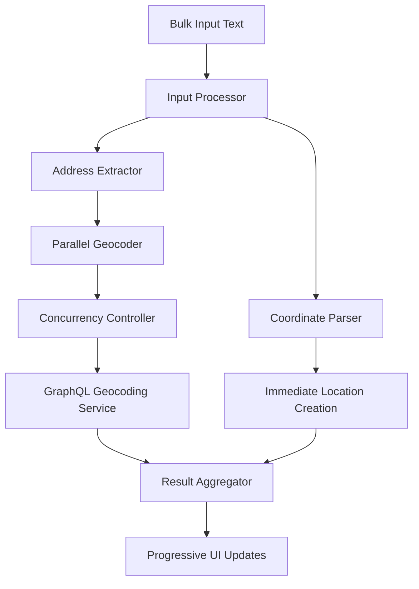

# Design Document: Parallel Bulk Geocoding

## Overview

This design transforms the current synchronous bulk address processing into a parallel system that immediately processes coordinates and geocodes addresses concurrently. The solution separates coordinate parsing from address geocoding, implements concurrency control using native JavaScript patterns, and provides progressive result display to improve user experience.

## Architecture

The parallel bulk geocoding system consists of three main components:

1. **Input Processor**: Separates coordinates from addresses and handles immediate coordinate processing
2. **Parallel Geocoder**: Manages concurrent address geocoding with rate limiting
3. **Result Aggregator**: Collects and displays results progressively as they complete



## Components and Interfaces

### Input Processor

The `BulkInputProcessor` class handles the initial separation and processing of input lines:

```typescript
interface BulkInputProcessor {
  processInput(inputText: string): Promise<BulkProcessingResult>
}

interface BulkProcessingResult {
  successful: Location[]
  failed: Array<{ input: string; error: string }>
  summary: {
    totalInputs: number
    coordinatesProcessed: number
    addressesProcessed: number
    errors: number
  }
}
```

### Parallel Geocoder

The `ParallelGeocoder` manages concurrent address geocoding with built-in rate limiting:

```typescript
interface ParallelGeocoder {
  geocodeAddresses(
    addresses: string[],
    onProgress: (result: GeocodingResult) => void
  ): Promise<GeocodingResult[]>
}

interface GeocodingResult {
  input: string
  success: boolean
  location?: Location
  error?: string
}

interface ConcurrencyController {
  readonly maxConcurrent: number
  execute<T>(tasks: (() => Promise<T>)[]): Promise<PromiseSettledResult<T>[]>
}
```

### Result Aggregator

The `ResultAggregator` handles progressive display and final result compilation:

```typescript
interface ResultAggregator {
  addCoordinateResult(location: Location): void
  addGeocodingResult(result: GeocodingResult): void
  getFinalResults(): BulkProcessingResult
}
```

## Data Models

### Enhanced Location Interface

The existing `Location` interface remains unchanged to maintain backward compatibility:

```typescript
interface Location {
  id: string
  name: string
  latitude: number
  longitude: number
  color: string
}
```

### Processing State Management

```typescript
interface BulkProcessingState {
  isProcessing: boolean
  totalItems: number
  processedItems: number
  coordinatesFound: number
  addressesFound: number
  errors: Array<{ input: string; error: string }>
}
```

## Correctness Properties

*A property is a characteristic or behavior that should hold true across all valid executions of a system-essentially, a formal statement about what the system should do. Properties serve as the bridge between human-readable specifications and machine-verifiable correctness guarantees.*

<function_calls>
<invoke name="prework">
<parameter name="featureName">parallel-bulk-geocoding

### Property Reflection

After reviewing all properties identified in the prework, several can be consolidated to eliminate redundancy:

- Properties 2.3, 4.1 can be combined into a single progressive display property
- Properties 2.4, 4.3, 5.3 can be combined into a comprehensive result aggregation property
- Properties 3.2, 3.3 can be combined into a single queue management property
- Properties 5.1, 5.2, 3.4 can be combined into a comprehensive error resilience property

### Correctness Properties

Property 1: Coordinate identification and immediate processing
*For any* bulk input containing valid coordinates in supported formats, all coordinate lines should be identified immediately and processed without waiting for address geocoding to complete
**Validates: Requirements 1.1, 1.2, 1.4**

Property 2: Parallel address geocoding initiation
*For any* bulk input containing multiple addresses, all address geocoding requests should be initiated concurrently rather than sequentially
**Validates: Requirements 2.1**

Property 3: Concurrency control and queuing
*For any* number of addresses exceeding the concurrency limit of 6, the system should process exactly 6 requests concurrently and queue the remainder, processing queued requests as slots become available
**Validates: Requirements 3.1, 3.2, 3.3**

Property 4: Progressive result display
*For any* geocoding result that completes successfully, the location should be immediately displayed on the map regardless of the status of other pending requests
**Validates: Requirements 2.3, 4.1**

Property 5: Comprehensive error resilience
*For any* geocoding request that fails, the system should continue processing all other requests, collect detailed error information, and handle failures without blocking other operations
**Validates: Requirements 3.4, 5.1, 5.2**

Property 6: Result aggregation and summary
*For any* combination of successful and failed geocoding attempts, the system should provide a complete summary displaying both successful locations and error details when all processing completes
**Validates: Requirements 2.4, 4.3, 5.3**

Property 7: Color assignment consistency
*For any* locations added progressively during bulk processing, color assignment should remain consistent and follow the existing color rotation pattern regardless of the order results arrive
**Validates: Requirements 4.4**

Property 8: Backward compatibility preservation
*For any* existing functionality including single address processing and result formats, the behavior should remain unchanged after implementing parallel processing
**Validates: Requirements 6.1, 6.2, 6.3, 6.4**

Property 9: Coordinate display with proper formatting
*For any* valid coordinate input, the processed location should display with appropriate colors, markers, and formatted names
**Validates: Requirements 1.3**

## Error Handling

### Geocoding Failures
- Individual geocoding failures are captured with detailed error messages
- Failed requests do not block other concurrent requests
- Error information is collected for final summary display
- Network timeouts and API errors are handled gracefully

### Input Validation
- Invalid coordinate formats are caught and reported as errors
- Empty or whitespace-only lines are filtered out during preprocessing
- Malformed addresses are passed to geocoding service for proper error handling

### Concurrency Control Errors
- Queue overflow protection (though unlikely with reasonable input sizes)
- Graceful degradation if concurrency controller fails
- Proper cleanup of resources when requests are cancelled

## Testing Strategy

### Dual Testing Approach
The system will use both unit tests and property-based tests for comprehensive coverage:

**Unit Tests** focus on:
- Specific coordinate format parsing examples
- Error handling scenarios with known failure cases
- Integration between components
- UI state management during progressive updates

**Property Tests** focus on:
- Universal properties across all input combinations
- Concurrency behavior with varying numbers of addresses
- Error resilience across different failure patterns
- Result consistency regardless of completion order

### Property-Based Testing Configuration
- Minimum 100 iterations per property test
- Each property test references its design document property
- Tag format: **Feature: parallel-bulk-geocoding, Property {number}: {property_text}**
- Use fast-check library (already available in web/package.json)

### Testing Framework
- **Jest** for unit tests and property test runner
- **fast-check** for property-based test generation
- **@testing-library/react** for component testing
- **MSW** for mocking GraphQL geocoding service

### Key Test Scenarios
1. **Concurrency Limits**: Test with 10+ addresses to verify only 6 process concurrently
2. **Mixed Input**: Test with combination of coordinates and addresses
3. **Error Resilience**: Test with mix of valid and invalid addresses
4. **Progressive Display**: Verify locations appear as geocoding completes
5. **Backward Compatibility**: Ensure existing single-address flow unchanged
