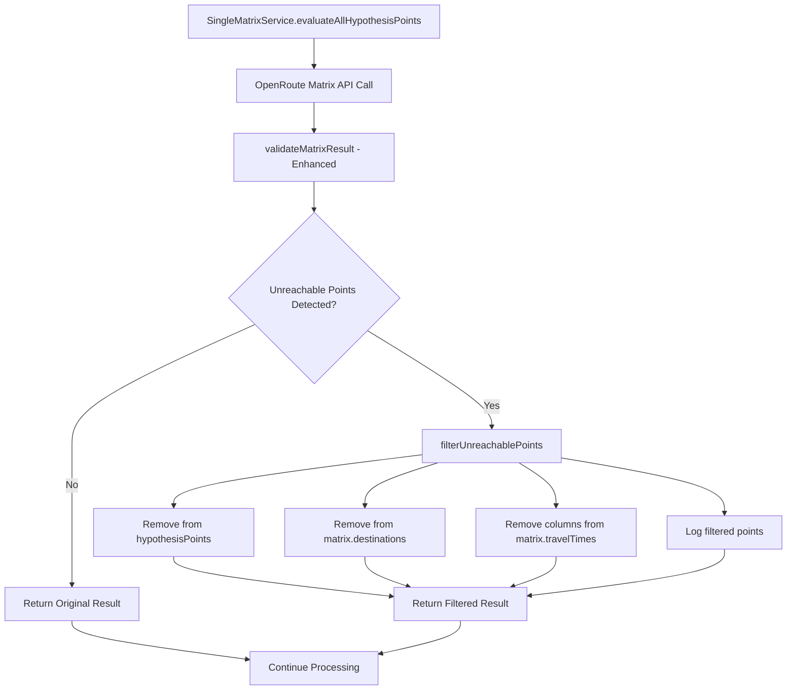

# Design Document: Unreachable Points Filtering

## Overview

This design addresses a critical bug in the SingleMatrixService where hypothesis points located over unreachable areas (lakes, restricted zones, disconnected road networks) cause system failures when the OpenRoute Matrix API returns null travel times. The solution implements robust filtering to automatically remove unreachable hypothesis points from the SingleMatrixResult, ensuring the system continues processing with only reachable points.

The design focuses on modifying the existing `validateMatrixResult` method to detect unreachable points and implementing a new filtering mechanism that maintains data consistency across all related data structures.

## Architecture

The solution follows a two-phase approach:

1. **Detection Phase**: Enhanced `validateMatrixResult` method identifies unreachable points by scanning the travel time matrix for null/undefined/Infinity values
2. **Filtering Phase**: New `filterUnreachablePoints` method removes unreachable points from all related data structures while maintaining consistency

### Component Interaction



## Components and Interfaces

### Enhanced validateMatrixResult Method

The existing `validateMatrixResult` method will be enhanced to detect unreachable points without throwing errors:

```typescript
private validateMatrixResult(
  matrix: TravelTimeMatrix,
  expectedOrigins: number,
  expectedDestinations: number
): { isValid: boolean; unreachableDestinations: number[] }
```

**Changes:**
- Returns validation result object instead of throwing errors
- Identifies unreachable destination indices
- Maintains existing dimension validation logic
- Adds null/undefined/Infinity detection for travel times

### New filterUnreachablePoints Method

A new private method will handle the filtering logic:

```typescript
private filterUnreachablePoints(
  matrix: TravelTimeMatrix,
  hypothesisPoints: HypothesisPoint[],
  unreachableIndices: number[]
): {
  filteredMatrix: TravelTimeMatrix;
  filteredHypothesisPoints: HypothesisPoint[];
  filteredCount: number;
}
```

**Responsibilities:**
- Remove unreachable hypothesis points from hypothesisPoints array
- Remove corresponding destinations from matrix.destinations
- Remove columns from matrix.travelTimes for unreachable points
- Maintain index consistency across all data structures
- Log filtering operations with coordinates and reasons

### Updated SingleMatrixResult Interface

The existing interface remains unchanged but will contain filtered data:

```typescript
export interface SingleMatrixResult {
  matrix: TravelTimeMatrix // Contains only reachable points
  hypothesisPoints: HypothesisPoint[] // Contains only reachable points
  apiCallCount: number // Unchanged
  totalHypothesisPoints: number // Original count before filtering
}
```

## Data Models

### TravelTimeMatrix Structure

```typescript
interface TravelTimeMatrix {
  origins: Location[] // Unchanged - origins are always reachable
  destinations: HypothesisPoint[] // Filtered to remove unreachable points
  travelTimes: number[][] // Columns removed for unreachable destinations
  travelMode: TravelMode // Unchanged
}
```

### Filtering Metadata

```typescript
interface FilteringResult {
  originalCount: number
  filteredCount: number
  removedPoints: Array<{
    coordinate: Coordinate
    reason: 'null_travel_time' | 'undefined_travel_time' | 'infinity_travel_time'
    affectedOrigins: number[]
  }>
}
```

## Correctness Properties

*A property is a characteristic or behavior that should hold true across all valid executions of a system-essentially, a formal statement about what the system should do. Properties serve as the bridge between human-readable specifications and machine-verifiable correctness guarantees.*

<function_calls>
<invoke name="prework">
<parameter name="featureName">unreachable-points-filtering

### Property Reflection

After analyzing the acceptance criteria, several properties can be combined to eliminate redundancy:
- Detection properties (1.1-1.3) can be combined into one comprehensive invalid travel time detection property
- Matrix consistency properties (2.2, 2.3, 3.1, 3.4, 3.5) can be streamlined into fewer comprehensive consistency properties
- Graceful degradation properties (4.1-4.3, 4.5) can be consolidated

### Correctness Properties

Property 1: Invalid travel time detection
*For any* travel time matrix containing null, undefined, or Infinity values in any destination column, the validateMatrixResult method should identify all destinations with invalid travel times as unreachable
**Validates: Requirements 1.1, 1.2, 1.3**

Property 2: Complete reachability checking
*For any* travel time matrix and destination column, if any origin row contains an invalid travel time for that destination, the destination should be marked as unreachable
**Validates: Requirements 1.4, 1.5**

Property 3: Consistent point filtering
*For any* set of unreachable destination indices, filtering should remove the corresponding hypothesis points from the hypothesisPoints array while maintaining correct index mapping with remaining points
**Validates: Requirements 2.1, 2.4**

Property 4: Matrix structure consistency
*For any* filtered matrix result, the travelTimes array dimensions, destinations array length, and hypothesisPoints array length should all be consistent and match the number of reachable points
**Validates: Requirements 2.2, 2.3, 3.1, 3.4**

Property 5: Data quality preservation
*For any* filtered matrix result, all remaining travel times should be valid numbers (not null, undefined, or Infinity) and the origins array should remain unchanged
**Validates: Requirements 3.2, 3.3**

Property 6: Index mapping preservation
*For any* filtered matrix result, the row-to-origin and column-to-destination mappings should remain correct after filtering
**Validates: Requirements 3.5**

Property 7: Graceful degradation with mixed reachability
*For any* hypothesis point set with some unreachable points, the system should continue processing with only the reachable points
**Validates: Requirements 4.1, 4.2, 4.3**

Property 8: Minimum reachability requirement
*For any* hypothesis point set where all points are unreachable, the system should enforce the requirement of at least one reachable point and handle this appropriately
**Validates: Requirements 4.5**

Property 9: Single-pass filtering efficiency
*For any* filtering operation, the algorithm should complete in a single pass through the matrix data without multiple iterations
**Validates: Requirements 5.1**

Property 10: Filtering operation ordering
*For any* matrix evaluation, filtering should complete before any scoring calculations begin
**Validates: Requirements 5.4**

Property 11: Comprehensive logging
*For any* filtering operation, all filtered points should be logged with their coordinates and reasons, and performance metrics should be recorded
**Validates: Requirements 2.5, 5.5**

## Error Handling

### Unreachable Point Detection

The system will detect unreachable points by checking for:
- `null` values in travel time matrix
- `undefined` values in travel time matrix
- `Infinity` values in travel time matrix
- Any negative values (invalid travel times)

### Graceful Degradation Scenarios

1. **Partial Unreachability**: When some hypothesis points are unreachable, continue with reachable points
2. **Type-Specific Fallback**: If all anchor points are unreachable, continue with grid points (and vice versa)
3. **Complete Unreachability**: If all hypothesis points are unreachable, throw descriptive error

### Error Messages

```typescript
// When all points are unreachable
throw new Error('All hypothesis points are unreachable from one or more origins. Please try different locations or travel modes.')

// When filtering reduces points below minimum threshold
throw new Error('Insufficient reachable hypothesis points after filtering. Please expand search area or adjust travel parameters.')
```

## Testing Strategy

### Dual Testing Approach

The implementation will use both unit tests and property-based tests for comprehensive coverage:

**Unit Tests** will focus on:
- Specific examples of unreachable point scenarios
- Edge cases (all points unreachable, single point unreachable)
- Error conditions and error message validation
- Integration points between filtering and existing validation

**Property-Based Tests** will focus on:
- Universal properties that hold across all input combinations
- Comprehensive input coverage through randomization
- Data consistency validation across different matrix sizes
- Performance characteristics under various filtering scenarios

### Property-Based Testing Configuration

- **Testing Library**: Jest with fast-check for property-based testing
- **Minimum Iterations**: 100 iterations per property test
- **Test Tags**: Each property test will reference its design document property
- **Tag Format**: `// Feature: unreachable-points-filtering, Property {number}: {property_text}`

### Test Data Generation

Property tests will generate:
- Random travel time matrices with controlled unreachable points
- Various combinations of null/undefined/Infinity values
- Different matrix dimensions and hypothesis point configurations
- Mixed reachability scenarios for graceful degradation testing

The testing strategy ensures that both concrete examples (unit tests) and universal behaviors (property tests) are validated, providing comprehensive coverage of the filtering functionality.
